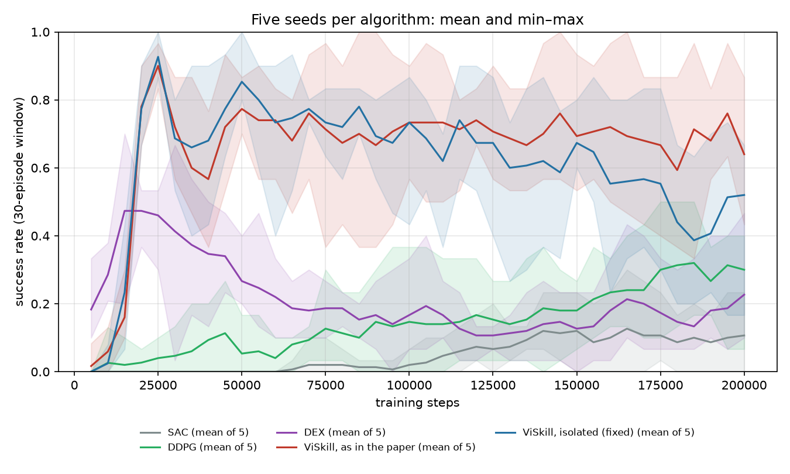

# HierRL-TissueRetract

**Hierarchical Skill Chaining vs. Demonstration-Guided Reinforcement Learning for Surgical Tissue Retraction: A Comparative Study**

Pradeep Surya Dadi — Khoury College of Computer Sciences, Northeastern University
CS 4180/5180 (Reinforcement Learning), Spring 2026 · `dadi.pr@northeastern.edu`

[](https://github.com/pradeepsuryad/hierrl-tissue-retract/actions/workflows/tests.yml)

📄 **[Read the paper](paper/hierrl-tissue-retract-aaai.pdf)** ([errata](paper/ERRATA.md)) · 🖼 [Poster](paper/poster_a0.pdf) · 📓 [Notebook](notebooks/hierrl_v2_final.ipynb) · 📚 [Deep dive](docs/DEEP_DIVE.md)

Autonomous tissue retraction — approach soft tissue, grasp it, lift it to a target
displacement, hold it without tearing — formalised as a continuous-control MDP with a
four-phase internal structure (APPROACH → GRASP → RETRACT → HOLD), and used to compare
four deep RL algorithms on a CPU-only Gymnasium environment with a simple kinematic tissue
model.

> **Corrected in October 2026.** Re-checking the paper against this code showed that
> ViSkill's sub-policies were not gradient-isolated as the paper says, that its results
> are single runs, and that several environment and reward details differ from the paper.
> The results below come from a five-seed re-run of the code;
> [paper/ERRATA.md](paper/ERRATA.md) lists every correction.

## Results: five seeds per algorithm

| Algorithm | Final SR | Peak SR | SR, last 50k steps | Mean SR | Mean reward |
|---|---|---|---|---|---|
| SAC | 10.7% | 21.3% | 10.1% | 4.8% | −5.7 |
| DDPG | 30.0% | 40.7% | 27.4% | 14.6% | −38.9 |
| DEX | 22.7% | 57.3% | 17.7% | 21.4% | **+16.7** |
| **ViSkill**, as in the paper | **64.0%** | 93.3% | **68.5%** | **66.0%** | −0.9 |
| ViSkill, isolated sub-policies | 52.0% | **96.7%** | 51.5% | 61.6% | +1.4 |

Mean of five runs per row (seeds 0, 1, 2, 3, 42), 200,000 training steps each, one CPU
thread per run. Success = tissue displacement ≥ 0.6 H\* held for 3 consecutive steps,
measured on a 30-episode sliding window of training episodes; "last 50k steps" averages
the last 10 logged windows. Ranges, per-run values and significance tests are in
[`results/rerun/summary.md`](results/rerun/summary.md). The paper's Table 2 is a single
run per algorithm, and its seed-42 numbers do not reproduce (errata, item 2).



**Hierarchy wins, and not by luck of the seed.** On success over the last 50k steps and on
mean success, every ViSkill run beat every SAC, DDPG and DEX run (p = 0.008, the smallest a
five-against-five permutation test can give). ViSkill first reaches 80% success at
20–25k steps; SAC's first success comes at 65–115k.

**Gradient isolation is not why.** The paper credits each sub-policy training only on its
own phase. In the code that produced its results, APPROACH's replay buffer doubled as the
value network's, so APPROACH also trained on every other phase. Giving the value network a
buffer of its own (the "isolated" row) did not help: over the last 50k steps the original
was ahead on all five seeds (p = 0.063, not significant with five runs each). What does
drive ViSkill's advantage has not been isolated here.

**Reward and success rank the algorithms differently.** DEX has the highest mean reward
(+16.7) but sustains only 17.7% success; DDPG reaches 30.0% final success with a mean
reward of −38.9. Neither metric alone summarises the four.

**DEX's early lead fades as its demonstrations are annealed out.** DEX has its first
success within 5k steps and reaches 50% by 15–25k steps in four of five runs. As the
behaviour-cloning weight anneals from 1 to 0 over 80k steps, its mean success falls from
37.6% (first 40k steps) to 22.7% (40–80k), then stays near 15%.

## The generalisation study

| Variant | Train SR | Eval SR | Gap |
|---|---|---|---|
| ViSkill-SAC (v2, 23D obs) | 60.0% | 10.0% | 50.0 pp |
| ViSkill-DEX (v3, 26D obs) | 80.0% | 30.0% | 50.0 pp |
| ViSkill-DEX (v3T, tuned) | 56.7% | 50.0% | 6.7 pp |

*Pre-fix runs from the paper; not reproducible from this repository.* Each is a single run:
train SR is the training-window success at 200k steps, and eval SR is the greedy policy on
10 held-out seeds (100–109). The 26D goal-aware observation, the ViSkill-DEX sub-agents,
the BC floor (λ_min = 0.15), the continuous HOLD reward and the held-out evaluation are
not in this code, and all three runs predate the buffer fix above. The paper reads v3T's lower training success and higher eval success as the BC floor acting as
a regulariser.

## The paper's conclusions, re-checked

| Conclusion in the paper | Status |
|---|---|
| 1. Hierarchy is necessary for contact-rich sequential tasks, and gradient isolation is the dominant factor | Hierarchy's advantage holds over five seeds (above). The gradient-isolation explanation does not (errata, item 1) |
| 2. Demo quality dominates demonstration-guided RL | The phase-separated demo controller succeeds on 50/50 episodes and the naive one on 0/50 (`scripts/verify_paper_claims.py`). DEX trained on each was not re-run |
| 3. Linear BC annealing to zero causes collapse; a floor λ ≥ 0.15 sustains performance | DEX does decline as λ anneals (above). The floor result comes from the v3T run: pre-fix runs from the paper; not reproducible from this repository |
| 4. Observation design is algorithmic design | From the v2 → v3T runs: pre-fix runs from the paper; not reproducible from this repository |
| 5. Continuous dense rewards beat binary cliff rewards near decision boundaries | From the v3 → v3T runs: pre-fix runs from the paper; not reproducible from this repository |

## Ablations

| Ablation | In the paper (single run) | Re-checked here |
|---|---|---|
| Phase-separated demo controller (jaw shuts before any translation) | 96% scripted success; DEX 50% peak | 50/50 scripted successes |
| Naive demo controller (jaw and translation together) | 0% scripted success; DEX 3.3% final | 0/50 |
| ViSkill without the −0.5 GRASP jaw bias | 0%, permanently stuck in APPROACH | not re-run |

The paper's 96% includes the 0.04 action noise the notebook's demo generator adds for
coverage; `scripts/verify_paper_claims.py` runs the controller without it.

## Environment

`TissueRetract-v0` — Gymnasium-compatible, CPU-only, no external physics engine.

| | |
|---|---|
| Observation | 23D: end-effector position, jaw opening, 7 joint values, 4 tissue-anchor positions |
| Action | 4D — Δx, Δy, Δz (±0.05 m per step), Δjaw (±0.1 per step, jaw opening normalised to [0, 1]) |
| Tissue | 4 anchors, placed kinematically each step: before the grasp they move 5% of the way back to rest; after it they follow the gripper, scaled by exp(−10 d) with d their distance from the grasp target. No masses or integration |
| Force | 50 N/m × mean anchor displacement; penalised above F_lim = 5 N, tear at 2 F_lim |
| Phases | APPROACH → GRASP within 0.06 m of the grasp target; GRASP → RETRACT when the jaw closes below 0.15 there; RETRACT → HOLD at 0.6 H\* |
| Randomisation | grasp target ~ U([−0.05, 0.05]³), anchor jitter ~ U([−0.02, 0.02]³), target height H\* ~ U([0.15, 0.20]) m |
| Termination | success (3 consecutive steps), tear, or 500-step truncation |

## Running it

```bash
pip install -e .
pytest tests/ -q                        # 25 tests
python scripts/verify_paper_claims.py   # the demo-controller claim (conclusion 2)
python scripts/check_errata.py          # every code-level item in paper/ERRATA.md
python scripts/rerun.py viskill-original 42 out.json   # one 200k-step run, 1.5-2.5 h on one core
python scripts/summarize_rerun.py       # results/rerun/*.json -> summary.md and the figure
```

`hierrl/` is extracted from `notebooks/hierrl_v2_final.ipynb`, the notebook behind the
paper. The environment was checked constant by constant against Table 1: spring constant,
force limit, tear threshold, randomised target height, the 0.6 H\* / 3-consecutive-step
success condition, jaw threshold and scale, translation scale, episode length, and every
per-algorithm learning rate, batch size, buffer and warmup, plus the 80k BC anneal horizon
and the −0.5 GRASP jaw bias. Where the paper's text disagrees with the code, the errata
say so. Both documented environment bug fixes are present and the tests pin them.

Changed since the paper:

- **ViSkill's buffer sharing is fixed** in the package and the notebook. The value network
  now has its own replay buffer; `ViSkill(..., approach_trains_on_all_phases=True)`
  restores the paper's behaviour, and the tests check both.
- **Two extraction bugs are fixed.** `train.py` and `dex.py` were missing imports, so the
  package could not train at all, and DEX crashed on its first update. A smoke test now runs
  every agent through `train()`.

**Seeds.** A seed fixes the environment's random stream, not the networks' initial
weights, because the agents are built before `train()` seeds PyTorch. For a run that
repeats exactly, call `hierrl.common.seed_everything(seed)` before building the agent; a
test checks this. The re-run in `results/rerun/` did not, so its runs are independent
samples.

`results/test_output.txt` is the output of the last full test run.

## Contents

```
hierrl/     the package: envs/tissue_retract.py, algos/{sac,ddpg,dex,viskill}.py,
            demos.py, train.py - extracted from the notebook
tests/      25 tests: the paper's Table 1 constants, both environment bug fixes,
            ViSkill's buffer isolation, seeding, and a training run of every agent
scripts/    verify_paper_claims.py, check_errata.py, rerun.py, summarize_rerun.py
results/    rerun/ (25 runs: JSON logs, summary.md, figure, progress-log extracts)
            and test_output.txt
paper/      the course paper (AAAI template; not submitted), the A0 poster, ERRATA.md
notebooks/  hierrl_v2_final.ipynb - the original end-to-end run, ViSkill cell now fixed
figures/    training dashboard and ViSkill skill timeline from the paper's single run
docs/       DEEP_DIVE.md - cell-by-cell walkthrough of every design decision
```

## Provenance

An earlier prototype repository (`hierrl_tissue_retract`) predated three environment
fixes that are load-bearing for these results — the success threshold (0.8 H\* held 10
steps → 0.6 H\* held 3), the spring constant (5 → 50 N/m) and randomised target height —
and reported near-zero success for every algorithm as a consequence. Its useful parts
have been folded into this repository, which is now the single reference implementation.

## Ethics

Simulation study only. No patient data, no physical robot experiments; the tissue is a
simple kinematic model. Real deployment would require clinical validation, regulatory
approval, and surgeon-in-the-loop oversight beyond this scope.
